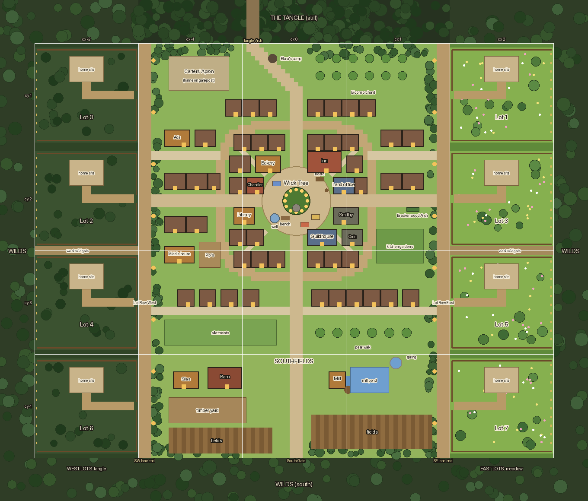

# Hearthwick 2: a town worth walking through

2026-10-15. Design written with the owner, against `exp/hearthwick-2` at `b316192` (one town on `dev`, not yet released). Docs only. `scripts/hearthwick-2-sketch.py` renders the blockout in [img/hearthwick-2-sketch.png](img/hearthwick-2-sketch.png).

[one-town.md](one-town.md) made Hearthwick one fixed 3×3-chunk place on `outdoors` with eight lots west of it. Playtesting it, the owner found three problems:
- the town is empty and over-wide;
- the seams into the Wilds are hard and straight;
- the lots are plain grass, where they used to look like the Wilds.

This doc redraws the town and moves the lots while migration 037 can still be edited in place, which is until the next release.



## 0. Owner decisions (2026-10-15)

1. **A tight market town that opens out toward the Wilds.** Close to the centre it's a dense market village: buildings shoulder to shoulder, narrow lanes, alleys. Farther out it opens up into gardens, yards and fields. Working places like the mill sit on the edge, not in the middle.
2. **Ring and spokes, scaled to people.** The plan borrows the owner's reference (a round square, spokes, a ring lane, a dense core, open outskirts) at about a third of its scale. Roads are sized to a 1-tile hero: main spokes 3 tiles, the ring lane 2, alleys 1. Houses are 4–8 tiles wide, in rows.
   - That's nearly 60 buildings where there are 6 today, most of them decoration for now. Interiors and new residents can come later, house by house.
   - The density in the sketch is accepted. The owner will judge it again by walking it.
3. **The centerpiece is the Wick Tree.** A great old oak stands in the middle of the square, with the town's hearth-stone at its foot. The well stays on the edge of the square.
   - **Its sap is the town's lamp oil** (owner, §9 #1). There's room for more lore later.
   - **No lanterns in the tree for now** (§9 #3). It's simply a fine tree. A tree that grows a lantern for each thing completed is a possible expansion, but it would need reworked completions and multiplayer.
4. **A 5×4-chunk fixed block.** The town keeps its 3×3 (`cx = -1..1, cy = 1..3`). A new south row, **Southfields** (`cx = -1..1, cy = 4`), holds the farm and the mill. The eight lots move into two columns of four: west at `cx = -2`, east at `cx = 2`, both `cy = 1..4`.
5. **Lots front the town and back onto the Wilds.** Each lot's gate opens off a **Lot Row** lane running down the town's inside edge. Its back edge faces the generated Wilds directly and is open. Plot services work inside the lot's bounds only. Extending a lot outward with lanterns plugs into the holds engine when that lands (§6).
6. **The lots look like the Wilds again**, painted with the Wilds ground painter.
   - The west lots are tangle-dark woods, like the Wilds already beside them. The east lots are meadow-bright, toward Lantern Road.
   - The generated outskirts on each side lean the same way.
7. **No hard seams, and the town in the Wilds' style.** The **whole town's ground** is painted by the Wilds painter: grass, cobbles, square, lanes and fields (owner, §9 #2). The Wilds art is the owner's favourite in the game, so the town should share it. Real Wilds trees, thinning toward the centre, replace the ring of identical town oaks.
8. **Silas moves out to a Southfields farmstead** with his barn and timber yard. Pell's deeds desk becomes a **land office** in town, so lots are claimed in town.
9. **The sketch is accepted as the plan:** layout, density, and Ada's house in the quiet north-west block. The mill pond is fed by a **spring** inside Southfields, so no water crosses the lot column.

---

## 1. The block at a glance

North is negative $y$. One chunk is $24\times24$ tiles. A **block-local** tile `(X, Y)` is world `(X - 48, Y + 24)`. The sketch and `scripts/hearthwick-2-sketch.py` use block-local tiles; the tables below give world tiles.

```text
cy   cx: -3      -2         -1        0         1         2        3
 0     Wilds   Wilds     [Tangle   Tangle    Tangle]   Wilds    Wilds
 1     Wilds  [Lot 0]  |  town     town      town   | [Lot 1]   Wilds
 2     Wilds  [Lot 2]  |  town     SQUARE    town   | [Lot 3]   Wilds
         wildgate ==== |                            | ==== wildgate
 3     Wilds  [Lot 4]  |  town     town      town   | [Lot 5]   Wilds
 4     Wilds  [Lot 6]  |  Southfields (farm, mill)  | [Lot 7]   Wilds
 5     Wilds   Wilds      Wilds   Wilds v    Wilds     Wilds    Wilds
                                South Gate
   | = Lot Row lanes (inside the town's footprint), open to the Wilds at the south end
```

| Part | Chunks | World tiles | Place |
|---|---|---|---|
| Hearthwick (town + Southfields) | `cx -1..1, cy 1..4` (3×4) | $x = -24..47,\ y = 24..119$ | `hearthwick`, layout 72×96 |
| West lots (tangle) | `cx -2, cy 1..4` | $x = -48..-25,\ y = 24..119$ | `lots-west`, zones `lot:0, 2, 4, 6` |
| East lots (meadow) | `cx 2, cy 1..4` | $x = 48..71,\ y = 24..119$ | `lots-east`, zones `lot:1, 3, 5, 7` |

That's 12 town chunks plus 8 lot chunks, 20 fixed chunks in all (one-town had 17). Standing in the square at chunk `(0, 2)` keeps the whole 3×3 town resident, as before.

**Exits to the Wilds:**
- **Tangle Arch** (north, unchanged at $x = 1..3,\ y = 24$).
- **South Gate** ($x = 11..13,\ y = 119$).
- The **south ends of both Lot Row lanes** ($x = -24..-22$ and $45..47$, $y = 119$).
- Two **wildgates**: 2-tile public paths between lots 2/4 and 3/5 at $y = 71..72$.
- Every lot's open back, which belongs to its household.

The **Brackenwood Arch** stays a portal on Lantern Road. The old West Gate and East Gate go away: the lot columns now stand where they were.

---

## 2. The town plan

### 2.1 Districts

| District | Where (world tiles) | Character |
|---|---|---|
| **The Square** | disc of radius 8 round $(12.5, 60.5)$: $x = 4..20,\ y = 52..68$ | Round cobbled plaza. The Wick Tree in the middle, the well, the bench, the notice board, Orrin's sign, and the three Carting stalls round its edge. |
| **The Core** (inside the Ring Lane) | $x = -4..29,\ y = 44..77$ | The market quarter. Shops face the square or the spokes. Townhouse rows sit behind them, with 1-tile alleys on the four diagonals. |
| **The Ring Lane** | rounded-square ring, 2 wide, about $x = -6..31,\ y = 42..79$ | Wraps the core. The outer rows of houses face onto it. |
| **North band** | $x = -21..44,\ y = 24..41$ | The Carters' Apron by the Tangle Arch, Elara's camp, the Bloom orchard, and a row of houses facing the ring. |
| **West and east bands** | $x = -21..-7$ and $29..44$ | Cottage blocks on short cross lanes ($y = 49..50$). Ada's house is in the north-west block. Kitchen gardens are east, and the Brackenwood Arch is on Lantern Road. |
| **South band** | $y = 80..95$ | The Middle house and Pip's garden, house rows on **Garden Lane** ($y = 85..86$), allotments, and a pear walk. |
| **Southfields** | $y = 96..119$ | Silas's farmhouse, barn and timber yard to the west. Tolley Mill on its spring-fed pond to the east. Fields along the south edge. |

### 2.2 Roads

| Road | Width | World tiles | Riding |
|---|---|---|---|
| **Tangle Lane** (north spoke) | 3 | $x = 11..13,\ y = 34..53$, bending north-west to the arch at $x = 1..3,\ y = 24$ | on foot inside the ring |
| **West Road** | 3 | $x = -21..5,\ y = 59..61$, to Lot Row West | " |
| **Lantern Road** | 3 | $x = 19..44,\ y = 59..61$, to Lot Row East; Brackenwood Arch at $x = 38..40,\ y = 62$ | " |
| **South Road** | 3 | $x = 11..13,\ y = 67..119$, to the South Gate | " |
| **Ring Lane** | 2 | superellipse round $(12.5, 60.5)$, inner radius 16.5, outer 18.5 | on foot |
| **Alleys** | 1 | the four core diagonals, and the backs of rows | on foot |
| **Cross lanes, Garden Lane** | 2 | $y = 49..50$ (west and east bands); $y = 85..86$, $x = -21..44$ | ride |
| **Lot Row West / East** | 3 + a 1-tile verge | $x = -24..-22$ / $45..47$ (verge $x = -21$ / $44$), $y = 24..119$ | ride |
| **Wildgates** | 2 | $y = 71..72$; $x = -48..-25$ and $48..71$ | ride |

The `town-walk` zone (no riding) becomes the ring's bounding rectangle, $x = -6..31,\ y = 42..79$. Riders dismount at the ring. Everywhere outside it, including Southfields and the lot rows, allows riding.

### 2.3 Buildings

All buildings face south (the art is three-quarter view, doors on the south wall). That's why the plan puts shops on the square's north arc and along the north sides of the spokes, and uses the square's south arc for the well and stalls. **Foot** is the collision footprint in tiles. The art is two tiles taller, for the roof.

| Building | Foot | World tiles (x, y of top-left) | Door step | Art | Inside |
|---|---|---|---|---|---|
| Hazel's Bakery | 6×4 | $(3, 50)$ | $(6, 54)$ | existing `p1:house-west` | `in:village:bakery` |
| The Inn | 8×5 | $(15, 49)$ | $(19, 54)$ | **new** | later |
| Chandler (lamp oil and candles) | 4×4 | $(1, 55)$ | $(3, 59)$ | **new** | later |
| Land office (Pell) | 5×4 | $(21, 55)$ | $(23, 59)$ | **new** | `in:commons:yard:deeds` |
| Library | 5×4 | $(-2, 62)$ | $(0, 66)$ | existing `commons-art:hearthwick-library` | `in:village:library` |
| Smithy | 6×4 | $(21, 62)$ | $(23, 66)$ | **new** (forge glow) | later |
| Wheel & Wick Guildhouse | 7×4 | $(15, 67)$ | $(18, 71)$ | **new** | later |
| Orrin's workshop | 5×4 | $(23, 67)$ | $(25, 71)$ | **new** | later |
| Ada's house | 6×4 | $(-18, 44)$ | $(-14, 48)$ | existing `p1:house-ada` | none (window spot) |
| Middle house (Pip's family) | 7×4 | $(-18, 71)$ | $(-15, 75)$ | existing `p1:house-middle` | none |
| Silas's farmhouse | 6×4 | $(-16, 100)$ | $(-14, 104)$ | existing `cottage-silas` | `in:commons:yard` |
| Barn | 8×5 | $(-8, 99)$ | $(-4, 104)$ | **new** | none |
| Tolley Mill | 4×4 | $(20, 100)$ | $(21, 104)$ | existing `mill-house` + wheel | `in:village:mill`, `:2` |
| Townhouses and cottages | 4×4 / 5×4 | about 45, per the sketch | — | **new**, 6 variants | none for now |

### 2.4 The Square and the Wick Tree

- **The Wick Tree** stands at the square's centre, with its trunk base solid at $x = 12..13,\ y = 60..61$. The canopy is about 8×7 tiles and the hero walks under it.
  - The canopy follows the year, like the Wilds trees.
  - A sap spile and bucket on the trunk carry the lore: the town's lamp oil is tapped from the tree.
  - No lanterns hang in it for now. The expansion idea (it grows a lantern for each thing completed) is noted in §9 #3.
- **The hearth-stone** sits at the tree's foot, $x = 12..13,\ y = 62$. It takes over the old Town Lantern's jobs:
  - the `hearth` glim spot (`rest: "village"`);
  - the `village-lamp` repair, a hearth lantern hanging over the stone (existing repair art).
- **The rest of the square:**
  - **Well:** $(7..8, 64)$, keeping `well-rope` and the `well-canopy` project.
  - **Hazel's patched bench:** $(9..10, 64)$, with `bench-slat`.
  - **Notice board:** $(17..18, 55)$.
  - **Orrin's crooked signpost:** $(19, 58)$, at the mouth of Lantern Road.
  - **Carting stalls:** `madder-stall`, `stall-b`, `stall-c` on the south and north-west arcs.
  - **Bunting:** strung across Tangle Lane and South Road at the square's mouths.
- **New-player spawn** is `(5, 60)`, on the square's west lip, facing the tree and Orrin. Within one phone screen are the tree, the well, Mara and Orrin.

### 2.5 Where everything that exists goes

Room IDs stay as they are (one-town decision 8). Every world tile below replaces the one-town coordinate.

| Thing | New position (world tiles) | Notes |
|---|---|---|
| Anchors `spawn`, `well`, `arch`, `east-road` | `(5, 60)`, `(9, 65)`, `(2, 26)`, `(39, 60)` | `arch` is unchanged |
| Anchor `south-gate` | `(12, 116)` | Just inside the gate |
| Anchors `west-gate` → `west-wildgate`, plus a new `east-wildgate` | `(-23, 71)`, `(46, 71)` | Lot Row mouths of the wildgates |
| Door anchors `bakery-door`, `library-door`, `yard-door`, `mill-door` | steps per §2.3 | `yard-door` is now the farmhouse |
| New anchor `land-office-door` | `(23, 59)` | Pell's room gets its own front door; the `office`/`shop` doors between yard and deeds rooms are removed |
| Anchors `lot:0..7` | the Lot Row tile outside each gate | §3.2 |
| **Mara** | loops round the tree $(9..16, 57..64)$ | `ROUTINES.hearthwick` |
| **Orrin** | by the signpost $(19, 58)$; his road-check walk goes out along Lantern Road | His workshop is decoration until it gets an interior |
| **Pip** | Pip's garden $x = -10..-6,\ y = 70..75$; laps inside it | `fence-rail` repair on the garden's gap |
| **Hazel** (`square`) | by the bench $(9, 63)$ | walks to her door at $(6, 54)$ |
| **Finn** (`door`) | outside the mill door $(21, 105)$ | |
| **Ada** (`window`) | under her window, about $(-15, 49)$ | `ADA_HOUSE_WINDOW` moves with the house |
| **Elara** (`camp`) | camp at $(6..8, 26..28)$, beside the arch | unchanged in spirit |
| **Silas** (`yard`) | by the sawhorse in the timber yard, $x = -17..0,\ y = 106..111$ | farm props: `sawhorse`, `timber-stack`, `skids`, `woodpile`, `firebox`, `toolbox` |
| Repairs | `well-rope` well; `village-lamp` hearth-stone; `bench-slat` bench; `fence-rail` Pip's garden; `library-roof` library door; `gate-hame` the Carters' Apron gatepost on Tangle Lane, about $(-4, 31)$ | same IDs and world flags |
| Pickups | `well-rope-coil` by the well; `oatcake-parcel` by Ada's step; `lane-glove` on the apron | |
| Papers | `pip-copybook-…` in Pip's garden; `why-the-tide-fox-…` by Ada's house; `elaras-note-…` on the mill pond bank | |
| Mill pond and fishing | pond $x = 25..33,\ y = 99..104$, race $x = 24,\ y = 101..103$, spring $(34..35, 97..98)$ | Banks `north`, `east`, `race` are redrawn round the new pond; `water:village:mill-pond` gets its new tile list |
| Gathering | `bloom-patch` ×5 under the orchard trees; `freshet-shore` ×3 on the pond's north rim; `pond-ice` ×3 on the pond | same festival tags |
| Lamps | `lamp:north` at the arch; `lamp:south` at the South Gate; lane lamps every 12 tiles on both Lot Row verges; a lamp at each wildgate mouth | The old east/west gate lamps go |

### 2.6 Walk times (hero 6.9 tiles/s on foot, 9.7 riding)

| Route | Tiles | Time |
|---|---:|---:|
| Spawn → Orrin | 14 | 2.0 s |
| Square → Bakery / Library / Land office | 8 / 12 / 12 | 1–2 s |
| Square → Tangle Arch | 36 | 5.2 s |
| Square → Mill | 51 | 7.4 s (riding from the ring: 6.0 s) |
| Square → nearest lot gate (lot 2 or 3) | 37 | 5.4 s |
| Square → farthest lot gate (lot 6 or 7) | 83 | 12 s on foot; 9.6 s riding past the ring |

Every town errand is still under 8 seconds. The farthest lot is 12 seconds away, down from one-town's 18.

---

## 3. The lots

### 3.1 Geometry

- Lot `g` sits in column `g % 2` (0 west, 1 east) and row `g / 2` (0 north to 3 south):

  ```text
  lotOrigin(g) = { tx: g % 2 ? 48 : -48, ty: 24 + 24 * floor(g / 2) }
  lotAt(cx, cy) = (cx == -2 || cx == 2) && cy in 1..4 ? (cy - 1) * 2 + (cx == 2 ? 1 : 0) : null
  ```

- The lot is still exactly one chunk. The **home site keeps its lot-local position** (`lx 8..15, ly 3..8`, doorstep `(11, 8)`, start light `(12, 7)` r 7). Migration 037's `(-8, -3)` shift of old homestead pieces is unchanged, and the cottage art still faces south.
- The **front** is the town side: `lx 23` on west lots, `lx 0` on east lots. The **back** is the opposite column. Everything else is mirrored left-to-right by side; nothing is rotated.

West lot, lot-local tiles (east lots are the mirror image):

```text
    lx 0 1 2 ...  8          15        21 22 23
ly 0  v v v v v v v v v v v v v v v v v v v v v v v v   verge: Wilds trees and shrubs (solid)
   1  f f f f f f f f f f f f f f f f f f f f f f f f   side fence
   2  : . . . . . . . . . . . . . . . . . . . . . . f
   3  : . . . . . . S S S S S S S S . . . . . . . . f   S = 8×6 home site
  ..  : . . . . . . S S S S S S S S . . . . . . . . f
   8  : . . . . . . S S S @ S S S S . . . . . . . . f   @ doorstep (11, 8)
   9  : . . . . . . . . . p p . . . . . . . . . . s f   s = lot sign on the fence
  10  : . . . . . . . . . p p . . . . . . . . . m . f   m = mailbox (21, 10)
  11  : . . . . . . . . . p p p p p p p p p p p p p G   G = gate (lx 23, ly 11..12)
  12  : . . . . . . . . . p p p p p p p p p p p p p G   ->  Lot Row lane (town)
  13  : . . . . . . . . . . . . . . . . . . . . . . f
  14  : . . . . . . . . . . . . . . . . . . . . . h f   h = gift shelf on the fence
  ..  : . . . . . . . . . . . . . . . . . . . . . . f
  21  : . . . . . . . . . . . . . . . . . . . . . . f
  22  f f f f f f f f f f f f f f f f f f f f f f f f   side fence
  23  v v v v v v v v v v v v v v v v v v v v v v v v   verge (or the wildgate path, between lots 2/4 and 3/5)
   ^ lx 0 = the lantern line: a row of lantern stakes, walkable, open to the Wilds
```

- **Private ground** is `lx 1..22, ly 2..21`: 440 tiles, up from 306. Add the two gate cells.
- **Reserved from placement:** the site, the L-shaped path (`lx 11..12, ly 9..10`, then `ly 11..12` running to the gate), the mailbox, the sign and shelf cells, and the gate.
- **The verges** (`ly 0` and `ly 23`) pair up between stacked lots into a 2-tile strip of Wilds trees and shrubs. That strip carries the woods from the Wilds into the lot rows.
- **The wildgate:** between lots 2/4 and 3/5, that same strip becomes the public path. Its fences stay on each lot's `ly 22` / `ly 1`, so the path runs between two fences.

### 3.2 Gate and road access

- The gate is in the front fence, at the lane. A lot's anchor `hearthwick:lot:<g>` is the lane tile outside its gate:
  - west lots: `(-23, ty0 + 11)`;
  - east lots: `(46, ty0 + 11)`.
- The **lot sign** and the **gift shelf** sit in the front fence line beside the gate. Neighbours use them from the lane, as now, so the lane needs no extra tiles.
- `HomeEntrance(g)` and `HomeDoorstep(g)` keep their meaning with the new origin. `HomeDoorstep` is still `lotOrigin(g) + (11, 8)`.
- **Lot names** become `West Row 1..4` and `East Row 1..4`, counted north to south.

### 3.3 Fence and service bounds

Owner decision: plot services work **inside the fence only**.
- `insideLot(tx, ty, g)` is `lx 1..22, ly 2..21`, plus the two gate cells.
- The back column `lx 0` (west lots) or `lx 23` (east lots) is the **lantern line**. It's walkable and outside the service bounds.
- Arrange, saw clearing, planting, home rest and gathering on the lot all check `insideLot`, as they do today.
- Nothing changes for neighbours: the lot stays `safe`, `sync` and `rest: "home"`, and anyone may walk in.

### 3.4 Migration 037, edited in place

Live players haven't run 037, so it changes in place.

| Piece | Change |
|---|---|
| `037_one_town.sql`, `home:<g>` → doorstep | `x = (CASE g%2 WHEN 0 THEN -48 ELSE 48 END + 11)*16 + 8`; the `y` formula is unchanged (`(24 + 24*(g/2) + 8)*16 + 8`) |
| `037_one_town.sql`, `village` saves | → the new spawn `(5, 60)`: `x = 88, y = 968` |
| `037_one_town.sql`, step-3 Commons saves (`y >= 384`) | → `hearthwick:arch`, unchanged (`40, 424`) |
| `migration_037_backfill.go` `reserved037` | New bounds and reservations. Out of bounds is `x < 1 \|\| x > 22 \|\| y < 2 \|\| y > 21`. Reserved are the site, the L-path (which depends on side: `x 11..12, y 9..12` plus `x 13..22` on west lots or `x 1..10` on east lots, `y 11..12`), the mailbox, and the sign and shelf cells. |
| `generate037` | Matches the new `homestead.json` land config (§4.2) so blocked-tile checks agree with the runtime generator |
| The `(-8, -3)` shift | Unchanged. The bigger bounds mean fewer old pieces are archived or returned to storage. |
| Upgrade test (`outdoors_upgrade_test.go`) | Fixtures assert the new doorstep for an even and an odd lot, and an item placed at old `x = 30` that is now in bounds |

The same constants change in `src/lib/lots.ts` (`lotAt`, `lotOrigin`, `homeEntrance`, `insideLot`, `lotAtPixel`), their Go twin, `content/places.json`, and the shared location vectors.

**Places.** `homestead-lots` (one 2×4 `plots` place) splits into two `plots` places, `lots-west` (`cx -2, cy 1`, 1×4) and `lots-east` (`cx 2, cy 1`, 1×4). Their zones `lot:0..7` and rules are as today. `hearthwick` grows to `height: 4`, with a 72×96 layout.

`PLOT_REVISION` goes to 3, so lot chunk caches built from the old geometry are dropped.

---

## 4. Lot ground: the Wilds again

### 4.1 How the lots looked, and why they lost it

Before one town, home land was its own area, painted with the Wilds ground in the Tangle's look: dark woods ground, moss, and a trodden clearing round the cottage, as in the owner's old screenshot. The blocky clearing patches came from clearing being drawn per tile.

One town composed the lots into a fixed footprint. The footprint is drawn with the **town tileset** (`groundFor` in `src/game/wilds/window.ts:578`; even with `groundStyle: 'tangle'`, it paints one tileset canvas per area). That is why the lots are bright, flat grass.

### 4.2 The new lot ground

- **The painter.** Lot chunks are painted like generated chunks: `src/game/wilds/ground-paint.ts`, per chunk, in the paint worker, from world pixels. The lot's ground table is built from `land.Generate`:
  - grass → the side's base ground;
  - the cleared site and path → `trodden`;
  - water and ford → `water`/`ford`.

  The cleared-tile overlay is feathered (the painter's soft edges) instead of square.
- **The two sides.** The difference between west and east is in the **ground mix and decor**, not the palette:

  | Side | Base ground | Decor (`land.Generate` counts) |
  |---|---|---|
  | **West, tangle** | `woods` with `moss` patches | `trees: 44, stumps: 6, boulders: 4`; oak, pine, birch and thicket mix |
  | **East, meadow** | `meadow` with sparse `moss` | `trees: 14, stumps: 3, boulders: 3`, plus a `flowers` scatter (code-drawn `wildflowers`) |

  `content/homestead.json` `land` gains a per-side block (`sides.west`, `sides.east`). The seed stays `land.Seed(world, lot, cfg)`.
- **The palette follows the year,** using the same `outer` look by Mark as the outskirts next door (Mudrise buds, Carting green, Amberfall russet, Quiet frost). A fixed Tangle palette on the lot would clash with the outskirts every other season.
  - The ground table is fixed per lot revision, so the cached chunk stays valid. Only the palette applied to it changes.
  - The town's own trees and grass follow the year the same way (§5).

---

## 5. Edge transitions

The seams in the screenshots have three causes. Each has a fix.

| Cause | Fix |
|---|---|
| The town's ground is a flat tileset; the Wilds are painted | **Paint the town's grass with the Wilds painter.** Use a `meadow` base, plus a `trodden` wear band along road edges. Its noise runs in world coordinates, so it carries straight across every boundary. |
| A wall of identical `oak-canopy` trees on a straight 3-tile border | **The border becomes Wilds decor.** Code-drawn oak, pine, birch and thicket from `tangle-art.ts`, in the Mark's palette. They're scattered with falling density over the town's outer 4–6 tiles, so the woods thin into the town rather than stopping at a line. Solid trunks only; canopies overlap the walkway. |
| Cobbles butt straight against Wilds dirt at the Tangle Arch | The road changes over **inside** the town: Tangle Lane goes from cobble to `road` and then `trodden` over its last 6 tiles before the arch. That matches the Tangle's `road` on the other side. |

**Collision at the seam:**
- **Kept edges.** Fixed chunks are already kept neighbours for `seamMirror` (one-town §4.2), and they mirror passable edge tiles into the generated chunk.
  - Today the open edges are only road mouths. The new **open lot backs** are 20 passable tiles in a row.
  - The generator therefore gets a **soft band** rule: in the first 3 generated tiles beside an open fixed edge, at most 1 tile in 4 may be solid, and never two in a row along the edge. The lot's back never faces a wall.
- **Closed edges.** The town's north row against the Tangle and the lot verges stay solid except at the openings listed in §1. The mirror closes the rest, as now.
- **Keeping camps away.** No camp, enemy spawn or dealt site within 6 tiles of a lot back or wildgate mouth. This uses the same distance check as the footprint keep-out in `cells.go`.

**The outskirts lean the same way:** the open map's land field (woods versus meadow) gets a bias inside ring 1 of the block. West of $x = -48$ it favours woods; east of $x = 71$ it favours meadow. Farther out it fades to the normal mix. This is a field offset in the generator, not a new land type.

---

## 6. Extending a lot with lanterns

The holds engine and dimming Lamps come next on the seamless path ([location-seam.md §0](location-seam.md#0-owner-decisions-2026-10-13): one town → holds and dimming Lamps → hearths), so this release only **sets up** extension. The model it plugs into:

- **The backland.** Each lot has one **backland chunk**: the generated chunk behind it, at `cx -3` for west lots or `cx 3` for east lots, same `cy`. Extension never reaches past the backland in this design. Later hearths in the Wilds are a separate claim.
- **The lantern line is the starting edge.** A member hangs a **lot lantern** on a lantern-line stake. It casts light into the backland like a way-lamp.
  - **Lit tiles** in the backland join the lot's service bounds. There you can arrange, clear, plant and gather, under world.md decision 10: what you make with materials lasts for good inside lamplight.
  - More lanterns can be set further out, each within the light of another, to grow the lit area.
- **Wick epochs.** The backland is a `wick` chunk and regenerates at each turning. A lit lot lantern puts a **hold** on its backland chunk: while the hold lasts, that chunk keeps its current epoch's terrain across turnings, like a kept chunk.
  - **Upkeep, recommended:** lamp oil each wick. That ties into the Wick Tree's sap (§9 #1).
  - **When the hold lapses** (unfed at a turning), the chunk regenerates with the next epoch. Pieces placed out there go back to home storage, the same rule 037 uses. Planted things are archived with a seed refund.
- **Storage.** Backland changes live in the existing homestead tables in **lot-local coordinates, extended past the lot**:
  - west lots: `lx -24..-1`;
  - east lots: `lx 24..47`.

  No new tables. `insideLot` stays the lot proper, and a new `lotLit(tx, ty, g)` adds lit backland tiles.

**In scope now:**
- the open lantern line;
- the stake art;
- the soft-band generator rule;
- the camp keep-out;
- making sure the homestead coordinate columns accept negative and >23 values (they're integers already, so no schema change).

**Later, with holds:** lot lanterns, the backland hold, upkeep, `lotLit`, and lapse handling.

---

## 7. Asset list for Codex Luna

**Global spec** (from [art-requests.md](../art-requests.md) "House style" and [art-request-playtest1.md](../art-request-playtest1.md)):
- Density is 64 texels per 16-px tile. **px** below means world pixels; texels are 4× that.
- The view is top-down three-quarter, facing south, not isometric.
- Chunky flat colour blocks with a 1-texel dark warm-brown outline `#3a2a28`, lit from the upper left. No gradients smoother than about 4 steps, no antialiasing, no painterly texture.
- **Luna's earlier passes shaded finer than the existing sprites** ([decisions-overnight.md](../decisions-overnight.md) #12). Match the coarseness of `p1:house-west`, not finer.
- Deliver to `assets/generated/hearthwick2-pass/`: source sheets, a manifest with each frame's rect and its bottom-centre foot point, `prompts.json`, a contact sheet, and a builder.

**Palette:**
- Emerald foliage with teal shadows, amber lanterns, russet wood and roofs, golden weathered stone, as in the playtest1 pass.
- Roofs vary between russet, slate blue-grey, moss-green and straw.

**Prompt preamble:** use the art-requests.md preamble ("Asset type: original low resolution RPG sprite for Fingersnap, a cozy lantern-lit pixel-art village RPG…") before each prompt below.

### 7.1 Centerpiece

| Key | Purpose | Foot (tiles) | Canvas px (texels) | Match | Frames | Prompt |
|---|---|---|---|---|---|---|
| `wick-tree-<mark>` ×4 (`mudrise`, `carting`, `amberfall`, `quiet`) | The square's great tree | trunk 2×1; canopy about 8×7 | 128×144 (512×576) | The Wilds' code-drawn oak (`src/game/wilds/tangle-art.ts`) scaled up, not the town `oak-canopy` PNG; leaf ramps from `src/game/wilds/wilds-looks.ts` per Mark | 1 each | "A huge ancient broad oak for a village square, wide low spreading crown, thick gnarled trunk with roots gripping the ground, a wooden sap spile and small bucket on the trunk; [Mark: pale spring buds / deep summer green / amber and russet autumn / frosted white-teal]." |
| `hearth-stone` | The town's hearth at the tree's foot: rest spot, holds the `village-lamp` repair | 2×1 | 32×24 (128×96) | golden weathered stone of `commons-well` | 3 (ember glow loop) | "A low round fieldstone hearth ring with glowing embers and a little smoke, worn smooth, set into cobbles." |

### 7.2 Buildings (all face south, door centred unless noted; roof 2 tiles above the foot)

| Key | Purpose | Foot | Canvas px (texels) | Match | Frames | Prompt |
|---|---|---|---|---|---|---|
| `townhouse-a/b/c` | Narrow core townhouses | 4×4 | 64×96 (256×384) | `p1:house-west` (`assets/generated/playtest1-pass/houses/fingersnap-house-west.png`) | 1 | "A narrow two-storey timber-framed village townhouse, steep [russet / slate / straw] roof, one lit window, flower box, door at the bottom centre." |
| `cottage-a/b/c` | Outer-band cottages | 5×4 | 80×96 (320×384) | `p1:house-middle`, the homestead `cottage` | 1 | "A cosy one-storey stone-and-timber cottage, [moss-green / russet / slate] roof, chimney, small porch." |
| `inn` | The Inn on the square | 8×5 | 128×112 (512×448) | `p1:house-west` | 1 | "A broad two-storey village inn, timber frame over a stone ground floor, double door, bench outside, hanging sign bracket, warm lit windows." |
| `chandler` | Lamp-oil and candle shop | 4×4 | 64×96 | `p1:house-west` | 1 | "A narrow candle-maker's shop, shop window with candles and oil jars, hanging lantern over the door." |
| `land-office` | Pell's deeds office | 5×4 | 80×96 | `cottage-silas` (`assets/generated/yard-pass/sheets/cottage-silas-source-v2.png`) | 1 | "A small tidy clerk's office, stone with a slate roof, a noticeboard of plot maps beside the door." |
| `smithy` | Smithy with forge | 6×4 | 96×96 (384×384) | `p1:house-west` | 1 + `forge-glow` 3 | "An open-fronted village smithy, stone forge with a chimney, anvil under a lean-to roof, tools on the wall." |
| `guildhouse` | Wheel & Wick Guildhouse | 7×4 | 112×96 (448×384) | `p1:house-middle` | 1 | "A wide civic guildhouse, stone and timber, a carved wheel-and-candle crest over the door, tall windows." |
| `workshop-orrin` | Orrin's sign-maker's workshop | 5×4 | 80×96 | `cottage-silas` | 1 | "A cluttered carpenter's workshop, half-painted signposts leaning by the door, wide shutters open." |
| `barn` | Silas's barn | 8×5 | 128×112 | `cottage-silas` | 1 | "A big red-brown timber farm barn, large double doors, hayloft door above, stone footing." |

### 7.3 Town and farm dressing

| Key | Foot | Canvas px | Match | Frames | Prompt |
|---|---|---|---|---|---|
| `shop-sign-<bread\|mug\|candle\|anvil\|scroll\|wheel>` | — | 12×12 | `plot-sign` wood | 1 each | "A small hanging wooden shop sign on an iron bracket showing a [loaf / mug / candle / anvil / scroll / cartwheel]." |
| `barrel`, `crate-stack`, `sack-pile` | 1×1 | 16×20 | yard-pass `timber-stack` | 1 | "A [wooden barrel / stack of crates / pile of grain sacks]." |
| `handcart` | 2×1 | 32×24 | `skids` | 1 | "A small two-wheeled wooden handcart." |
| `water-trough` | 2×1 | 32×20 | `commons-well` stone | 1 | "A stone water trough." |
| `washing-line` | 3×1 | 48×24 | — | 2 (sway) | "A washing line between two posts with linen." |
| `haystack`, `scarecrow` | 2×2, 1×1 | 32×32, 16×32 | barn | 1 | "A round haystack / a patched scarecrow." |
| `fruit-tree-<mark>` ×4 | trunk 1×1 | 32×40 | Wilds oak scale (`tangle-art.ts`, 30×32) | 1 each | "A small orchard pear tree, [blossom / green with pears / russet / bare frosted]." |
| `allotment-bed` | 2×1 | 32×16 | farmland ground tile | 1 | "A raised vegetable bed with neat rows of greens." |
| `spring-stones` | 2×2 | 32×32 | pond rim `sand` and stone | 2 (water ripple) | "A small spring welling up in a ring of mossy stones." |

### 7.4 Lots and edges

| Key | Foot | Canvas px | Match | Frames | Prompt |
|---|---|---|---|---|---|
| `lantern-stake` | 1×1 | 16×24 (64×96) | `world-lantern-post-*` (items pass) | 2 (bare, with a lit lantern for later) | "A short weathered wooden boundary stake with an iron hook, for hanging a lantern; lit variant with a small amber lantern." |
| `lot-gatepost-side` | 1×1 | 14×44 | delivered `gatepost` | 1 | Same as `gatepost`, a pair for the side gates (mirrored by flip). |
| `wildgate-arch` | 2×1 | 40×48 | Brackenwood Arch | 1 | "A low rustic arch of two bent saplings tied over a footpath, a tiny lantern hook at the top." |

**Ground: no new tiles.**
- The meadow, woods, trodden, road and paving grounds come from `ground-paint.ts`.
- The whole town is painted (§9 #2), so cobbles, the square's paving and tilled fields become painter categories (`cobble`, `paving`, `tilled`) in H3. That is code, not art.
- **Natural dressing should match the Wilds' code-drawn style** (`src/game/wilds/tangle-art.ts`), not the town PNG trees: the Wick Tree, the fruit trees and the spring. The owner wants the town to share the Wilds' look. Buildings stay in the house style.

About 55 frames in all.

---

## 8. Build lanes

| Lane | Delivers | Depends | Runs alongside |
|---|---|---|---|
| **H0. Art (Luna)** | §7 assets as `hearthwick2-pass`, with contact sheet | this doc | everything |
| **H1. Layout and contract** | `places.json` (`hearthwick` 3×4, `lots-west`, `lots-east`, the anchors in §2.5), the 72×96 `hearthwick.json` authored by a script from §2 (existing art plus placeholder boxes for new buildings until H0 lands), coordinate moves in rooms, residents, repairs, items, papers, fishing, gathering, story, quests and `ROUTINES`, the lot helpers in TS and Go, `homestead.json` sides, location vectors | — | H0, H3 |
| **H2. Migration 037 in place** | §3.4: SQL, backfill, upgrade tests | the H1 lot helpers (agree the constants first) | H3, H4 |
| **H3. One ground pipeline + first-load fix** | Fixed chunks paint through the chunk painter in the worker, per chunk, like generated chunks: town ground table, lot sides, feathered clearings, Mark palettes. Remove the eager `groundFor` for every footprint in the `WildsWindow` constructor (`window.ts:145-159`), which is **the ~1 s first-load regression**: both footprints' tilesets are built before the first frame. With the painter, only attached chunks paint, and off the main thread. Measure before and after with `perf/seam.perf.ts`. | H1 ground grids (a stub is fine to start) | H1, H2, H4 |
| **H4. Seams and generator** | §5 Go: soft band beside open fixed edges, camp keep-out, woods/meadow field bias, frontier and `keptBoxes` for the 5×4 block, ports and routes to the South Gate, lane ends and wildgates, the Wend clear of the lot columns | H1 places | H2, H3 |
| **H5. Town life and dressing** | Install H0 art; the Wick Tree (seasonal canopy) with the hearth-stone rest and repair; dressing placement; Pell's land office door; Silas on the farm; NPC routines retuned; Brackenwood Arch and signs | H0, H1, H3 | — |
| **H6. Review, perf and playtest** | Cross-family review, phone perf walk through all exits, owner playtest list | all | — |
| *Later:* **Lot lanterns** | §6 with the holds engine | holds | — |

- H1, H3 and H0 can start at once. H2 and H4 start as soon as H1's helpers and places land.
- The other lane's lot fixes (stuck behind a lot; the overlay not reaching the edges) touch the same lot geometry. Merge them first and rebase H1 on them. Their tests should move with the new bounds.

---

## 9. Questions settled on 2026-10-15

| # | Question | Owner's answer |
|---|---|---|
| 1 | **The Wick Tree's lore** | **Sap → lamp oil.** Amber is hardened sap, and Lamps' oil recipes already use amber (lamps.md), so no new rules are needed. The chandler sells it, and lot-lantern upkeep (§6) burns it. More lore can come later. |
| 2 | **Cobbles and fields: tileset or painter?** | **Painter for everything.** H3 adds `cobble` and `tilled` categories (`paving` exists). The result is one ground pipeline, no tileset canvas built at load, and a town that follows the year. The owner likes the Wilds' art best and wants the town to share it. |
| 3 | **Lanterns in the Wick Tree** | **Not now.** It's simply a fine tree. **Expansion idea:** the tree grows a lantern for each thing completed. That needs reworked completion tracking and multiplayer, so it's out of this design. |
