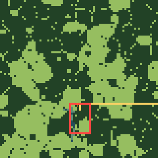
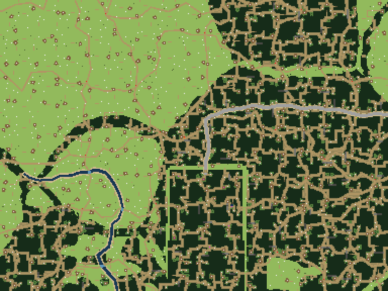
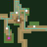
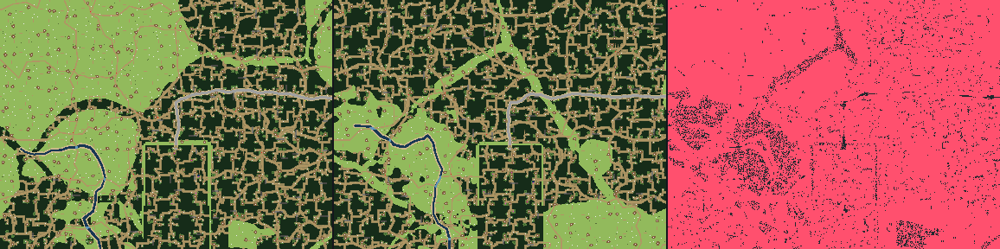

# World lab v0

A database-free Go tool that calls `server/internal/wilds` directly (the renderer lives in `server/internal/worldlab`; a dev build of the server serves the same lab in the browser, below). Run from the repository root:

```sh
nix develop -c nice -n 10 go build -o /tmp/worldlab ./server/cmd/worldlab
nice -n 10 /tmp/worldlab atlas --seed map --rect=-500,-500,499,499 /tmp/atlas.png
nice -n 10 /tmp/worldlab region --seed map --rect=-8,-12,7,-1 /tmp/region.png
nice -n 10 /tmp/worldlab chunk --seed map --at=-1,-3 /tmp/chunk.png
nice -n 10 /tmp/worldlab diff --seed map --seed-b=wide-world --rect=-8,-12,7,-1 /tmp/diff.png
nice -n 10 /tmp/worldlab diff --seed map --content=content/wilds.json --content-b=/tmp/tuned-wilds.json --rect=-8,-12,7,-1 /tmp/tuning.png
```

Put flags before the output filename. Rectangles have **inclusive chunk coordinates**, north is negative y, and `--at` also takes chunk coordinates. `--epoch` accepts a wick season such as `t:1795000000:1796209600` (the reproducible default). Still footprints automatically use their still epoch. `--scale` sets pixels per chunk in atlas, pixels per tile in region/chunk; defaults are 1, 1, 4. `--workers` defaults to at most four and accepts 1–8. `diff --view=atlas|region|chunk` uses the same options as that view, including `--at` for a chunk.

The default `--content=content/wilds.json` reads the current file without rebuilding the binary. Use `--content ''` for the binary's embedded content. Each version is decoded and validated in a fresh worker process before generation, rebuilding the generator's content-derived lookups once. Other game content stays embedded. There is no database, player state, persisted seam data, or running game service involved. Generated seams use the generator's default neighbours.

## Views and overlays

Atlas samples **glimpses only**, never chunks. A pixel is a chunk's centre land, tinted blue when the Wend crosses it. Region generates chunks in parallel and paints each ground tile, darkening solid tiles. Chunk paints the same ground at 4×, marks entities/sites/places, and traces paths through the walkability graph. Unknown grounds get a stable opaque fallback colour from the shared Go palette; the older frontier render tests use the same palette.

Each overlay is a boolean flag, or use `--overlays=land-cells,place-cells,tiers,wend,road,rumours,frontier,solid,reach`:

| Flag | Shows |
| --- | --- |
| `--land-cells` | Land sampling lattice in magenta; not the warped patch borders |
| `--place-cells` | Place cell lattice in cyan |
| `--tiers` | Stable colour tint for difficulty tier |
| `--wend` | Blue river crossings in atlas; water/ford tiles in generated views |
| `--road` | Gold road; atlas uses conservative road segment bounds |
| `--rumours` | Orange cross at the wick's rumour |
| `--frontier` | Red outline of the current generator's public frontier rectangle; never clips generation |
| `--solid` | Pink solid tiles, dark open tiles; chunk top/left edges show red/green solid/open share |
| `--reach` | Walkability-tree paths to boundary samples and markers; cyan boundary-connected, orange isolated |

Solid and reach require tiles and are rejected for atlas. Entity markers are white, sites magenta, lamp stones yellow, rumours orange, places red. Authored fixed chunks appear as grey hatching in regions and are excluded from tile metrics; requesting one as a standalone chunk reports why it cannot be generated.

Diff panels are **A, B, changed**, left to right. Pink marks changed units. Atlas compares centre land and river crossing. Tile views compare ground IDs, solidity, decor, entities, sites, and places; overlays and colour changes do not produce false tile changes. Content versions need matching chunk sizes.

## Measurements

Every PNG has a sibling `out.png.json` and prints the same report on stdout. It records seed, epoch, rectangle, content path and SHA-256, centre-land shares, the longest horizontal/vertical run of centre-land samples, and render time including PNG encoding (worker initialization/content validation excluded). Tile views also report ground shares, solid share, camps and places per 100 generated chunks, and unreachable walkable tiles. Atlas omits metrics it cannot know from glimpses.

Reach counts 4-neighbour walkable components that touch neither the render boundary nor omitted authored ground. A cropped route leaving the image is treated as reachable. This is a local diagnostic, not proof of reachability from the Commons gate across unseen terrain. Axial centre samples can miss narrow hems; the longest run is also a diagnostic, not the generator's tile-level land-cap test.

Measured on this host at `nice -n 10`: 1,000 × 1,000 atlas chunks in **5.88 s**, with **zero generated chunks**; 100 generated chunks / 57,600 tiles in **55 ms**. These timings vary with other lanes sharing the host. Image limits: atlas ≤ 1M chunks; tile views ≤ 2.4M tiles; each scaled panel ≤ 16M pixels. Coordinates are bounded to keep generator arithmetic and allocations reasonable.

## Local viewer over SSH

On the development host:

```sh
nice -n 10 /tmp/worldlab serve --addr 127.0.0.1:8099
# Optional saved baseline for the comparison panel:
nice -n 10 /tmp/worldlab serve --addr 127.0.0.1:8099 --content-b=/tmp/baseline-wilds.json
```

On your own computer:

```sh
ssh -N -L 8099:127.0.0.1:8099 <dev-host>
```

Open <http://127.0.0.1:8099>. Drag to pan, wheel/buttons to zoom through atlas → region → chunk, select views directly, edit seed/epoch/rectangle, toggle overlays, and click for tile/chunk/land/ground/entities. Enable Compare and set Seed B (or leave it empty to compare the configured content files). The stats panel then shows both versions and their changed share. Clicking the changed panel inspects version B.

The page polls content hashes once per second and re-renders when either configured content file changes, including atomic editor saves. Invalid content displays the validation error while retaining the previous image; the next valid save retries. Each render returns its PNG and stats together. One render request runs at a time, chunk parallelism stays bounded, and abandoned requests cancel their worker processes. The listener accepts explicit loopback addresses only. Stop with Ctrl-C.

## In the browser, on a dev server

A dev build of the server (`go build -tags dev`, as on the staging instance) serves the lab itself: open the dev panel (the backquote key, or Menu → Dev) and press **Open the world lab**. It shows for an account the settings give `server.dev.world_lab` (on with `dev.enable`, for `dev.accounts`), and on a local dev build without settings for callers on that machine. A release server has no such routes, and a release web build has none of the page.

- **Pan and zoom** by dragging, the wheel, a pinch, or the arrow and +/− keys. *Auto* shows the atlas below a pixel a tile and the region view above; *Atlas*, *Region* and *Chunk* pick one (chunk: the chunk in the middle, at 8 px a tile, with reach paths). Your hero is the gold dot when the seed is your world's.
- **Seed and epoch** start at your world's seed and the wick it is in now (*Your world, now*); *Reproducible epoch* is the CLI's default.
- **Overlays, stats, a tile:** the View tab toggles the overlays; Stats shows the last render's report (both versions and what changed in a diff); tapping a tile opens the Tile tab.
- **Compare** shows A, B and what changed side by side (one at a time on a phone): another seed for B, or the server's rules for one side and your edited copy for the other.
- **Rules:** an editable copy of the server's `content/wilds.json`, kept in that browser. It is checked as you type (where the JSON breaks, then the server's validation), and *Download* saves it for a lane to commit. Renders with "edited rules" send it along; the server's own rules never change.
- **Go here** moves your hero to the tile (or the nearest open tile in its chunk) through the world scene's own warp: only where you stand changes, saved like a step. It always lands in your own world, so the page warns when the shown seed, epoch or rules aren't your world's as it is now, and it is off for a chunk your world doesn't reach yet (the server's `location.OnGridPublished`, which would refuse the save). On authored ground it lands on the very tile picked.

Routes, all under `/api/dev/worldlab/` behind the dev gate: `GET state` (defaults, limits, the embedded rules), `POST render` (`{view, seed, epoch, rect, scale, overlays, rules?, b?: {seed, rules?}}`, answered with the PNG and its stats together), `POST tile` (`{seed, epoch, at: [tx, ty], rules?}`) and `POST check` (`{rules}`).

How it keeps off the game's back:

- **Every render and tile runs in a worker process**, the server binary again (`glimway-server _worldlab-worker`), whatever its rules. Edited rules are installed only there (`wilds.ConfigureForTools`), so they can't reach the generator the game uses; the server process only decodes them to report errors (`content.DecodeWilds` is pure). Even embedded renders go to a worker, to keep their CPU at a low priority and their memory out of the game's heap.
- Workers run at **nice 15** (the whole process group, so every thread), with `GOMAXPROCS=2`, `GOMEMLIMIT=768MiB`, two chunk workers and a **60 s** limit; an abandoned request kills its worker.
- **At most two workers at once** (a diff's two panels run side by side and take both); a request waits up to 30 s for one, then gets a 503.
- The CLI's **limits** hold (atlas ≤ 1M chunks, tile views ≤ 2.4M tiles, ≤ 16M pixels, scale 1–8, coordinates ±100,000), request bodies are at most 512 KiB, and identical requests are answered from a **128 MiB cache** of recent answers.

Measured on this host through the worker, at nice 15 with `GOMAXPROCS=2`: a 1,000 × 1,000 chunk atlas in **6.5 s**; a 64 × 64 chunk region (2.36M tiles, reach on) in **3.9 s**. The page asks for what the screen shows plus a margin, so usual requests are far smaller.

## Example renders

Each example has its complete measured JSON report beside it.

Atlas, seed `map`, chunks `-40,-60` through `39,19`, 4 px/chunk, frontier/road/rumour overlays:



Region, seed `map`, chunks `-8,-12` through `7,-1`, 2 px/tile:



Chunk, seed `map`, chunk `-1,-3`, 4 px/tile with reach paths and markers:



Diff, seeds `map` and `wide-world`, chunks `-8,-12` through `7,-1`, 1 px/tile:


