# Walk any way: before and after (0.14 iteration 1)

World lab renders (`server/cmd/worldlab`, seed `map`, the default wick epoch, 1 px a tile) of
`origin/dev` at `ca026ad8` (**before**) and `exp/open-world` (**after**). Each area is 16×16
chunks. Region rects are inclusive chunk coordinates; north is negative y.

| Area | Rect | Before | After |
|---|---|---|---|
| South of town | `-8,4,7,19` | 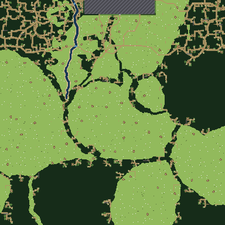 | 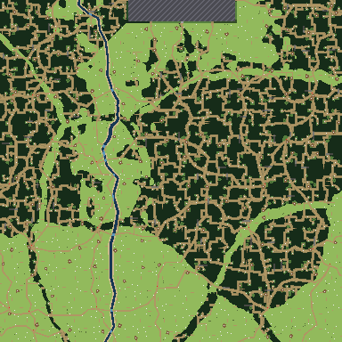 |
| Far east | `200,-8,215,7` | 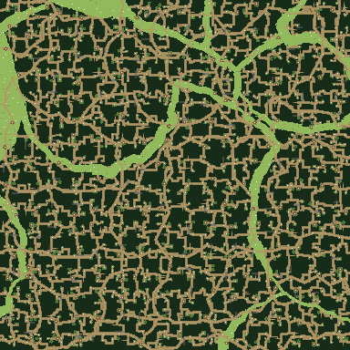 | 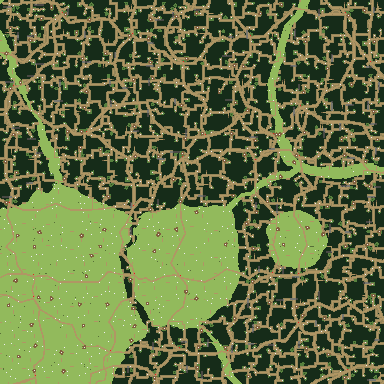 |
| Far west | `-215,-8,-200,7` | 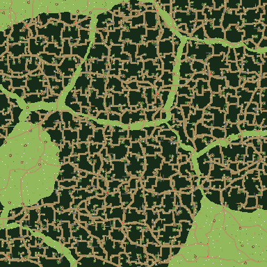 | 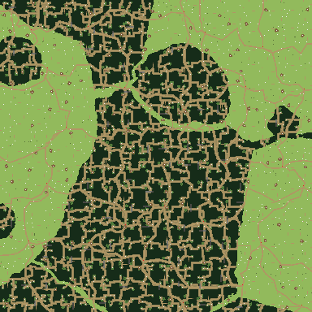 |
| Far north | `-8,-215,7,-200` | 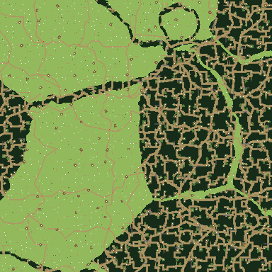 | 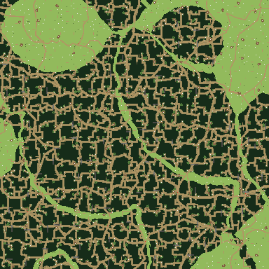 |
| Atlas round home | `-64,-64,63,63`, 2 px a chunk | 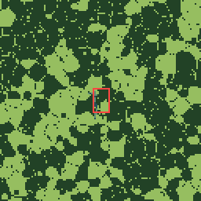 | 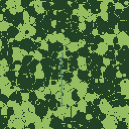 |

And the east border, chunks `4081,-8` to `4096,7` (after only; the border overlay outlines the
last chunk column): 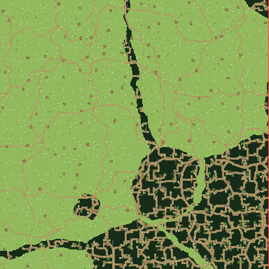

## What the numbers say

From each PNG's lab report (`worldlab region … out.png` prints it):

| Area | Solid share | Places / 100 chunks | Path ground | Camps / 100 chunks |
|---|---|---|---|---|
| South, before | 35% | **2.8** | **3.9%** | 44 |
| South, after | 34% | 10.4 | 11.7% | 55 |
| East, before → after | 51% → 40% | 12.1 → 11.3 | 15.0% → 13.3% | 55 → 55 |
| West, before → after | 45% → 31% | 12.5 → 10.9 | 14.2% → 11.8% | 55 → 53 |
| North, before → after | 28% → 41% | 10.2 → 10.2 | 11.2% → 13.6% | 58 → 58 |

- **The south.** Before, the places and routes passes stopped at the frontier's south limit
  (`cy` 7), so south of town there were almost no places and no paths between them. In this
  generator it was not one solid thicket (the brainstorm's measurement was older): the woods and
  meadows were there, but empty and unconnected. After, the south has as many places and paths
  as anywhere else, and the Wend runs on south past the mill.
- **East, west and north** were never cut off by the generator, only by the frontier. They look
  different before and after because the landform now hashes its own version (`LandformV1`)
  rather than `GeneratorVersion`, so every river and ridge moved once (accepted in the brief).
  The shares stay in the same range.
- Camps match `origin/dev` (0–1 a chunk) elsewhere; the south gained some along with its
  places.
